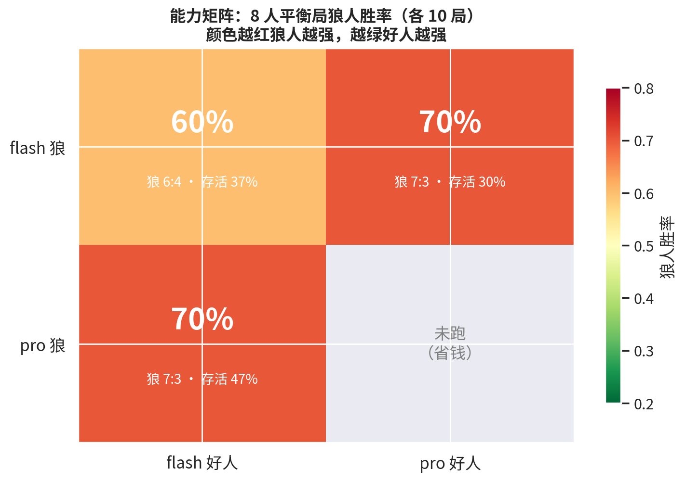

# 🐺 多 Agent 狼人杀 · 人机对战平台

> 和 5-7 个 AI 同桌玩一局真正的狼人杀。
> 它们会焊跳预言家、自刀骗药、倒钩卖队友、发言玩梗整活，
> 赛后还会亮出身份跟你复盘甩锅——
> 底层是一套严格信息隔离的多智能体博弈引擎，支持多模型混编与批量实验。


<!-- 截图位：在 docs/images/ 下补两张图后取消注释即可


-->

## 🚀 30 秒上手

```bash
git clone https://github.com/youzy139/langrensha.git
cd langrensha
pip install -r requirements.txt
```

在项目根目录新建 `.env` 文件，填入任意 OpenAI 兼容接口（默认按 DeepSeek 配置）：

```
LLM_BASE_URL=https://api.deepseek.com
LLM_API_KEY=sk-你的key
```

启动并开玩：

```bash
cd webapp
python server.py        # 浏览器打开 http://localhost:7100/
```

想停掉服务器：在运行它的终端按 `Ctrl + C`；端口被旧进程占用时启动会自动清理，直接重跑即可。

## 👥 多人组局（局域网同房对战）

一个人当房主启动服务器（`python server.py` 即可，默认已监听局域网），其他人：

1. 浏览器打开 `http://房主IP:7100`（房主 IP 用 `ipconfig` 查，如 `192.168.1.5`）
2. 首页切到「👥 多人房间」→ 输入昵称 → 输入房主给的 4 位房间码加入
3. 人齐了点「开始对局」（仅房主可操作），人数不足由 AI 自动补位
4. 打完一局回房间大厅，房主可以直接再来一局

规则与单人局完全一致（6/8 人局、角色随机洗牌）。有人挂机超过 75 秒会由 AI 托管代打，回来任意操作即可接管，游戏永不断流。首次启动时 Windows 可能弹防火墙提示，选"允许"即可。

## 🎮 玩法：你亲自下场

浏览器打开即玩，不用任何客户端：

- **选局型**：6 人局（2 狼 + 预/女 + 2 民）或 8 人局（3 狼 + 预/女/猎 + 2 民）
- **选身份**：随机，或指定当狼人 / 预言家 / 女巫 / 猎人 / 平民（猎人仅 8 人局，选择时会自动提示）
- **真实对局体验**：
  - 当狼：狼人私密频道和 AI 队友实时商量刀谁、谁焊跳，可以**自刀骗解药**
  - 当神：夜里验人 / 救人毒人 / 临死开枪，白天听 AI 发言抓漏洞
  - 当民：在 AI 的焊跳和对跳里分辨真假预言家，也可以装神挡刀
- **🎤 语音输入**：发言和提问支持语音实时转文字（浏览器自带识别，点麦克风说完再手动发送），键盘输入随时可用
- **全程沉浸设计**：每个 AI 行动前显示"💭 Alice 正在组织发言"动效、右侧栏实时标记出局玩家、关键信息（跳身份/查杀/票型）自动**加粗**、AI 发言有梗有节目效果但逻辑在线
- **终局不散场**：身份揭晓 + AI 解说员复盘（逐轮点评、每人高光/失误/评分）+ **赛后讨论区**——点名谁谁回（"Bob 你为什么验我？"只有 Bob 答），不点名全场一起答，它们会亮出身份、交出自己掌握的私密信息和当时的推理
- **历史对局**：每一局自动存档，大厅随时回看完整对话与复盘，不用开新局

## ✅ 验证与测试

**验收标准（全部达成）：**

| 标准 | 状态 |
|---|---|
| 一键跑完一局，终端实时打印白天发言 | ✅ `python main.py` |
| 对局结束输出 `data/cli/<时间>/game.jsonl`，含每轮完整 prompt 和回复 | ✅ 含 reasoning 内心戏 |
| 多局不卡死（超时 + 重试 + 兜底） | ✅ 50+ 局真实对局无一局中断 |

**离线回归测试（无需 API Key）：**

```bash
# 终端 1：Mock 模式启动服务器（不调用 LLM，内置剧本应答）
WEREWOLF_MOCK=1 python webapp/server.py --port 7209       # Windows: set WEREWOLF_MOCK=1 && ...

# 终端 2：端到端回归——完整对局 + 赛后讨论 + 历史回看 + 连开第二局
python webapp/test_ws_client.py 7209
# 期望输出：PASS: 全部通过
```

稳定性设计（针对真实 API 的限流与长思考）：

- **JSON 结构化输出**：所有决策走 schema，解析失败带反馈自动重试（默认 3 次）
- **指数 token 预算**：reasoning 模型空回复时按 2ⁿ 加大 max_tokens（1500→12000），超时同步放宽
- **发言兜底通道**：结构化输出全失败时切换免格式直答，杜绝"思考过载"卡死
- **断点续跑**：批量实验每局带 checkpoint，中断可续

## 🧠 这些 AI 玩家为什么"像人"

AI 不是各自为战的答题机器，而是一套有纪律的博弈系统：

- **严格信息隔离**：GameMaster（上帝）是唯一全知者；每个 PlayerAgent 的私有记忆（身份/验人/夜间行动/狼人频道）与公开记忆物理分离，AI 只能基于"发给自己的信息"行动——伪装和推理都建立在真实的信息不对称上
- **夜间战术 → 白天执行**：狼人频道的协商记录会写入每只狼的私密记忆，夜里说"明天我跳预言家"，白天就必须跳——战术一致性由记忆架构保证
- **角色化策略 prompt**：平民会焊跳挡刀、预言家掌握起跳时机、女巫管理银水毒药、狼人分冲锋/倒钩打法，还有严格的保密纪律（自刀后绝不认领银水）
- **鲜活的发言人格**：prompt 层鼓励幽默、玩梗、吐槽和节目效果，但要求幽默必须建立在信息量之上

## 📊 实验：多模型混编对抗（5 组 × 10 局真实对局）

引擎支持每个玩家配置不同模型，于是可以做"能力不对称"实验：

**能力矩阵 · 8 人平衡局（3 狼 + 预/女/猎 + 2 民）狼人胜率：**

| 狼 \ 好人 | flash 好人 | pro 好人 |
|---|---|---|
| **flash 狼** | 60%（6:4） | 70%（7:3） |
| **pro 狼** | 70%（7:3） | 未跑 |



关键发现（详见 [实验报告](docs/EXPERIMENT_REPORT.md)）：

1. **配置效应（±40pp）远大于模型效应（±10-20pp）**：6 人局好人碾压、8 人 3 狼局狼人占优
2. **反直觉：强模型当好人反而压不住狼**——pro 好人抓狼更准（狼存活率降至 30%），但狼队只需把好人犯错"武器化"即可取胜
3. 强模型当狼提升真实：pro 狼存活率 47%，显著高于 flash 狼的 30-37%

批量实验（支持断点续跑，可反复调用直到跑满）：

```bash
python run_experiment.py --config config_pro_wolves_8p.yaml \
    --logdir 8p_pro_wolves --total 10 --budget 240
```

## 🏗 架构

```
                    ┌─────────────────────────────┐
                    │        GameMaster（上帝）     │
                    │  唯一全知 · 状态机驱动        │
                    │  夜晚→白天→胜负判定           │
                    └───────┬───────────┬─────────┘
                   公开广播  │           │  私密投递
              ┌─────────────┘           └─────────────┐
        ┌─────▼─────┐  ┌─────────┐  ┌─────────┐  ┌───▼─────┐
        │ PlayerAgent│  │PlayerAgent│ │PlayerAgent│ │ 🤖/🧑   │
        │ 狼人 A(pro)│  │ 狼人 B(pro)│ │预言家(flash)│ │ 你(人类) │
        └─────┬─────┘  └────┬────┘  └─────────┘  └─────────┘
              └──────┬──────┘
              狼人私密频道（仅狼人可见）
                     │
        每个 Agent = 角色 System Prompt + 私有记忆 + 公开记忆
        所有决策 = JSON 结构化输出（解析失败带反馈自动重试）
                     │
              全量事件 → 每局独立 JSONL 日志（含完整 prompt / 回复 / reasoning）
                     │
        ┌────────────┼────────────┬──────────────┐
        ▼            ▼            ▼              ▼
   Web 人机对局   AI 解说员复盘   批量实验统计   胜率可视化
```

## 终端模式与纯 AI 局

```bash
python main.py --human                # 终端人机局：你随机替换一个 AI 上场
python main.py --human Carol          # 指定座位（身份游戏中揭晓）
python main.py --replay --review      # 纯 AI 局 + HTML 回放 + AI 解说复盘
WEREWOLF_MOCK=1 python main.py        # Mock 离线测试（无需 API Key）
```

## 项目结构

```
├── main.py                    # 终端入口：单局/多局 + 回放 + 复盘 + --human 人机局
├── run_experiment.py          # 批量实验：断点续跑 + 胜率统计
├── config.yaml                # 玩家/角色/模型/规则 全配置驱动
├── werewolf/
│   ├── gamemaster.py          # 上帝：状态机 + checkpoint 断点续跑
│   ├── player.py              # PlayerAgent：双层记忆 + 结构化决策 + 发言兜底
│   ├── roles.py               # 角色 System Prompt（狼/预/女/猎/民 + 风格纪律）
│   ├── llm.py                 # 异步 LLM 客户端：超时/重试/指数预算/JSON 解析
│   ├── logger.py              # JSONL 结构化日志（断档自动恢复）+ 控制台输出
│   ├── review.py              # AI 解说员复盘（坏行容错）
│   └── replay.py              # HTML 回放页生成
├── webapp/                    # Web 人机对局：FastAPI + WebSocket
│   ├── server.py              # 单人对局服务器：角色洗牌/思考动效/赛后点名讨论
│   ├── rooms.py               # 多人房间：建房/加入/AI 补位/挂机托管
│   ├── feedfmt.py             # 引擎文本 → 前端结构化消息（发言/投票/公告/出局）
│   ├── archive.py             # 对局存档读写（data/web/<对局ID>/）
│   ├── index.html + static/   # 前端：月下村庄场景、圆桌座位、手绘角色牌、纪事流、终局复盘
│   └── test_*_client.py       # Mock 端到端回归测试（单人 / 多人房间）
├── docs/EXPERIMENT_REPORT.md  # 完整实验报告
├── docs/PROJECT_GUIDE.md      # 代码精读指南（学习向）
└── data/                      # 所有运行产物（结构见 werewolf/paths.py）
    ├── web/<对局ID>/          # Web 对局：record.json（回放）+ events.jsonl（完整日志）
    ├── cli/<时间>/            # main.py 命令行对局：日志 / 回放页 / 复盘
    ├── experiments/<组>/      # 批量实验：只有 stats.json 和精选复盘入库
    └── mock/                  # WEREWOLF_MOCK=1 的离线测试产物，可整个删掉
```

## 路线图

- [x] 6 人局（2 狼 + 预/女 + 2 民）
- [x] 8 人局 + 猎人
- [x] Web 人机对局（指定身份 / 狼人频道 / 思考动效 / 历史回看）
- [x] 赛后讨论（点名提问 / 全员亮身份交换信息）
- [x] 语音输入（语音实时转文字）
- [x] 狼人自刀等进阶战术规则
- [x] 多模型混编与批量实验
- [x] AI 解说复盘 / HTML 回放
- [x] 局域网多人同房对战（房间码加入 / AI 补位 / 挂机 AI 托管）
- [ ] 对局中断线重连（重连恢复座位与私密信息）
- [ ] 更大规模样本（50-100 局/组）收窄置信区间
- [ ] Elo 评分体系：模型间循环赛排名
- [ ] 更多角色（守卫/白痴/骑士）与 12 人标准局

## License

MIT
